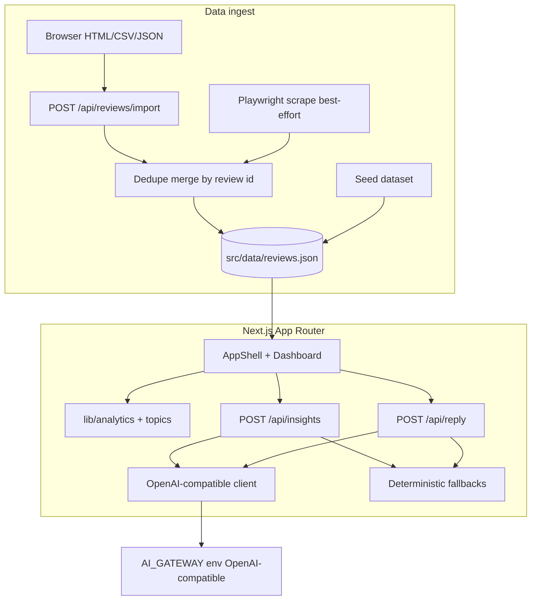

# Architecture — Azzurro Review Insights

## Purpose

Ops dashboard for **Azzurro Hotels** (Sydney) so non-technical staff can see Booking.com guest sentiment across four properties, act on recurring issues, and draft replies — without needing a Booking.com partner API for this trial.

**Live demo:** https://azzurro-review-insights-orpin.vercel.app  
**Repo:** https://github.com/ganesh12122/azzurro-review-insights

## High-level design



**Principles**

1. **Dashboard always works offline** — charts/KPIs/topics are deterministic from JSON.
2. **AI is optional** — Ops Brief + Draft Reply use env gateway; if missing/failing → rule-based text.
3. **Import is primary collection** — Booking.com WAF often blocks cloud scrapes; honesty over fake “sync OK”.
4. **No secrets in git** — keys only in `.env.local` / Vercel env.

## Stack

| Layer | Choice |
|---|---|
| UI | Next.js 16 App Router, React 19, TypeScript |
| Styling | Tailwind CSS 4, brand tokens (navy `#0a1b33`, accent `#e91e8c`) |
| Fonts | Fraunces (display) + DM Sans (body) |
| Charts | Recharts |
| Icons | Lucide |
| AI | OpenAI-compatible `POST /v1/chat/completions` via `AI_GATEWAY_*` |
| Hosting | Vercel |
| Data | JSON/CSV files (no required DB for demo) |
| Scrape (optional) | Playwright + Cheerio |
| Cron (optional) | GitHub Actions daily ~00:00 Sydney |

## App structure

```
src/
  app/
    page.tsx                 # Insights (loads reviews server-side)
    import/page.tsx          # Admin: upload reviews
    sync-logs/page.tsx       # Admin: sync history
    api/
      insights/route.ts      # Ops Brief (AI + fallback)
      reply/route.ts         # Draft reply (AI + fallback)
      reviews/import/route.ts
      sync/route.ts
  components/
    AppShell.tsx             # Fixed sidebar, mobile drawer, collapse
    dashboard/
      Dashboard.tsx          # KPIs, charts, topics, feed
      OpsBriefPanel.tsx      # AI brief + session cache
      DraftReplyButton.tsx
      InfoTip.tsx
      ImportPanel.tsx
      SyncLogsView.tsx
  lib/
    types.ts
    analytics.ts             # Filters, week KPIs, trends, topics rollup
    topics.ts                # Keyword topic rules
    loadReviews.ts
    importReviews.ts
    ai/
      client.ts              # Env-only OpenAI-compatible client
      opsBrief.ts
      reply.ts
  data/
    properties.ts
    reviews.json
    sync-log.json
    sample-reviews.csv
scripts/
  seed-reviews.mjs
  scrape-reviews.mjs
  import-html.mjs
.github/workflows/daily-review-sync.yml
```

## Data model (review)

Key fields in `src/lib/types.ts`:

- `id` — stable id for dedupe (seed/scrape/import)
- `propertyId` — one of four portal properties
- `reviewDate`, `overallScore` (1–10)
- `title`, `pros`, `cons`, `text`
- `topics[]`, `sentiment` (`positive` | `neutral` | `negative`)

**Sentiment:** ≥8 positive, 6–7.9 neutral, &lt;6 negative.

**Topics:** keyword rules for cleanliness, check-in, staff, noise, facilities, location, room-condition, value.

**Week KPIs:** ISO weeks (Mon–Sun) relative to latest review date in the filtered set (keeps demos meaningful).

## UI routes

| Route | Role |
|---|---|
| `/` | Insights — filters, KPIs, Ops Brief, charts, topics, review feed + draft reply |
| `/import` | Upload HTML/CSV/JSON; merge + dedupe |
| `/sync-logs` | Last sync status + history; optional Sync now |

Shell: navy sidebar (collapsible on desktop/tablet), mobile top bar + drawer. Brand aligned with [azzurrohotels.com](https://www.azzurrohotels.com/).

## AI layer

| Env | Purpose |
|---|---|
| `AI_GATEWAY_KEY` | Bearer token |
| `AI_GATEWAY_BASE_URL` | Base URL ending at `/v1` |
| `AI_GATEWAY_MODEL` | Model alias |

All three required for live AI. No provider URL/key hard-coded in source.

| Feature | Endpoint | Fallback |
|---|---|---|
| Ops Brief | `POST /api/insights` | Rule-based summary + actions from KPIs/topics |
| Draft reply | `POST /api/reply` | Template thank / apology reply |

Ops Brief caching:

- **Default view** (all properties, no dates/sentiment/search): **one shared AI brief per Australia/Sydney calendar day** for every staff member (server memory + `/tmp` or `src/data/ops-brief-cache.json`).
- **Custom filters:** rule-based brief by default; **Generate AI brief** spends tokens once and shares that result for the rest of the Sydney day.
- **Refresh** forces a new shared brief for the current scope.


## Collection strategy

| Path | Reliability | Notes |
|---|---|---|
| Seed JSON | High | Demo baseline |
| HTML/CSV/JSON import | High | Primary free path |
| Playwright scrape | Low–medium | Often WAF-blocked from cloud |
| GitHub Action daily | Best-effort | Logs `ok` / `partial` / `blocked` / `failed` |

On Vercel, import/sync **file writes are ephemeral** — treat Import as local/dev unless you add storage + redeploy. Demo uses committed `reviews.json`.

## Security notes (trial)

- Do not commit `.env.local` or secrets.
- Public demo APIs are unauthenticated — fine for private trial URL; add auth before wide public use.
- AI spend controlled by Ops Brief cache + optional gateway limits.

## Production next steps (out of trial scope)

1. Booking Connectivity / partner review API or approved vendor (e.g. managed scrape).
2. Persist reviews in a DB or object store; track reply status for real response-rate KPIs.
3. Auth for admin import/sync/AI routes.
4. Category scores if available from source data.
5. Optional LLM topic classifier behind the same `TopicId` schema.
